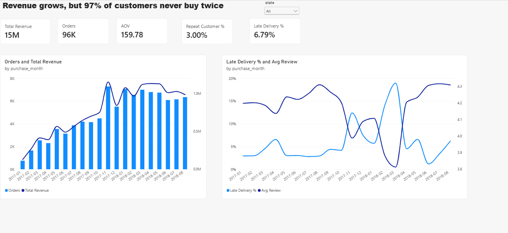
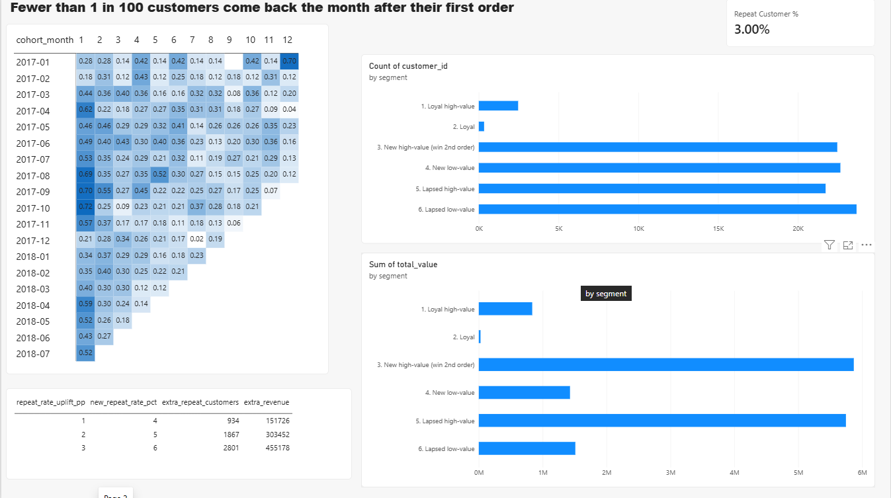
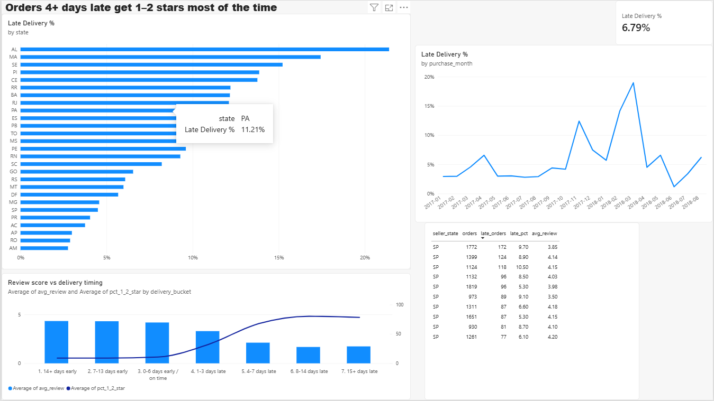

# E-commerce Customer Retention & Delivery Analysis

**Business question:** Why isn't revenue compounding for this e-commerce marketplace, and what should the business fix first?

**Tools:** SQL (SQLite: CTEs, window functions, cohort and RFM analysis) · Python (pandas) · Power BI (DAX) · business recommendation memo

📊 **Dashboard:** [PDF](dashboard/dashboard.pdf) · [Power BI file](dashboard/ecommerce_retention.pbix)
📝 **Recommendation memo:** [PDF](docs/recommendation_memo.pdf)



---

## Key findings
1. **Retention is the main leak.** Only **3.0%** of 93K customers ever place a second order, and repeat customers bring in just **5.6%** of R$15.4M revenue. In every monthly cohort, fewer than **1%** of customers return in any single month after their first order.
2. **Late delivery damages ratings.** Average review falls from **4.3** (delivered early) to **2.1** (4–7 days late), and **68–80%** of orders 4+ days late get 1–2 stars. Lateness spiked to **19%** in Mar 2018 and is worst in north-eastern states (AL, MA, SE: 15–21%). 9 of the 10 sellers with the most late orders are in São Paulo, which points to long-distance shipping.
3. **Hypothesis rejected.** Customers with a late first order repeat less (**3.0% vs 4.0%**), but only ~7% of orders are late, so the revenue lost this way is only **≈R$6K**. Fixing delivery alone won't fix retention.

## Recommendations
1. **Second-order program** for new high-value customers (the largest revenue segment, ~38% of revenue, all one-time buyers): **+2 pp repeat rate ≈ R$303K** (≈2% of revenue)
2. **Carrier capacity on SP → north-east routes** before peak periods (Nov, Feb–Mar)
3. **Seller delivery scorecard** with alerts for long-distance orders




## Data
[Brazilian E-Commerce Public Dataset by Olist](https://www.kaggle.com/datasets/olistbr/brazilian-ecommerce): ~100K orders (2016–2018) across 8 related tables. Currency: Brazilian real (R$).

## How it works
```
data/raw/*.csv ──► scripts/01_load_data.py ──► data/olist.db (SQLite)
                     └─ sql/00_build_model.sql  → order_facts, customer_facts
data/olist.db ──► scripts/02_run_analysis.py ──► sql/01..12 ──► outputs/*.csv ──► Power BI
```

| Query | Answers |
|---|---|
| `01_business_kpis` | Headline KPIs |
| `02_monthly_trend` | Revenue, orders, late % by month |
| `03_cohort_retention` | % of each monthly cohort that returns |
| `04/05_rfm_segments` | Customer segments by recency and value |
| `06_delivery_vs_reviews` | Delivery delay vs review score |
| `07_first_order_experience_vs_repeat` | Does a bad first order stop repeat purchases? |
| `08_state_performance` / `09_category_performance` | Where revenue and problems concentrate |
| `10_seller_late_delivery` | Which sellers cause late orders |
| `11_late_delivery_revenue_impact` | Revenue cost of late first deliveries |
| `12_retention_scenarios` | Value of a +1/2/3 pp repeat-rate lift |

## Reproduce
```bash
pip install -r requirements.txt
# download the Olist CSVs from Kaggle into data/raw/
python scripts/01_load_data.py
python scripts/02_run_analysis.py
```

## Limitations
Observational data: findings are correlations, not proven causes, so the recommendations should be A/B tested. Incomplete months (2016, Sep–Oct 2018) are excluded from trends.

---
**Author:** Vinayak Seth · [GitHub](https://github.com/Vinayak-Seth)